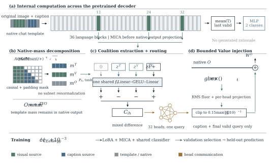

# MICA

**Native-Mass Coalition Interaction in Pretrained Attention for Multimodal Sarcasm Recognition**

MICA separates text and visual Value messages using the original attention normalization, extracts their non-additive interaction, and routes it across heads before a bounded update to the attention output.

<p align="center">
  
</p>

## Setup

Use Python 3.10+ and a CUDA-enabled GPU.

```bash
git clone https://github.com/CICC-XJTLU/MICA.git
cd MICA
pip install torch==2.6.0 torchvision==0.21.0 --index-url https://download.pytorch.org/whl/cu118
pip install -r requirements.txt
hf download Qwen/Qwen3-VL-4B-Thinking --local-dir models/Qwen3-VL-4B-Thinking
```

For the 8B configurations, download `Qwen/Qwen3-VL-8B-Thinking` into `models/Qwen3-VL-8B-Thinking`.

## Data

Obtain the benchmark from [MMSD2.0](https://github.com/JoeYing1019/MMSD2.0) and place JSONL splits in `data/clean/{train,val,test}.jsonl`. Each record contains `id`, `text`, `image`, and `label`. Image paths are absolute or relative to the repository root; labels are `sarcastic` / `not_sarcastic`, or `1` / `0`.

The paper uses cleaned splits of 19,344 / 2,393 / 2,409 pairs. Paths and expected split sizes are specified in each configuration; adjust them for a different prepared split. Data and pretrained weights are not included.

## Training and Evaluation

Run from the repository root:

```bash
CUDA_VISIBLE_DEVICES=0 python -m scripts.train --config configs/qwen3vl4b/mica.json

CUDA_VISIBLE_DEVICES=0 python -m scripts.evaluate \
  --checkpoint outputs/qwen3vl4b/mica/checkpoint-best \
  --data data/clean/test.jsonl
```

Configurations cover MICA, LoRA, additive, and no-routing controls at both 4B and 8B scales. Training selects the checkpoint by validation macro-F1 and then evaluates it on the test split. Evaluation saves predictions, class probabilities, and metrics. Use `--resume` with the training command to resume an interrupted run.

## Results

MICA on the cleaned MMSD2.0 test split:

| Backbone | Accuracy (%) | Macro-F1 (%) |
|:--|--:|--:|
| Qwen3-VL-4B-Thinking | 86.43 | 86.31 |
| Qwen3-VL-8B-Thinking | 87.71 | 87.61 |

## Tests

```bash
python -m unittest discover -s tests -v
```

## License

Code is released under [Apache-2.0](LICENSE). Built on [Qwen3-VL](https://github.com/QwenLM/Qwen3-VL), [Transformers](https://github.com/huggingface/transformers), and [PEFT](https://github.com/huggingface/peft); third-party notices are in [NOTICE](NOTICE).
